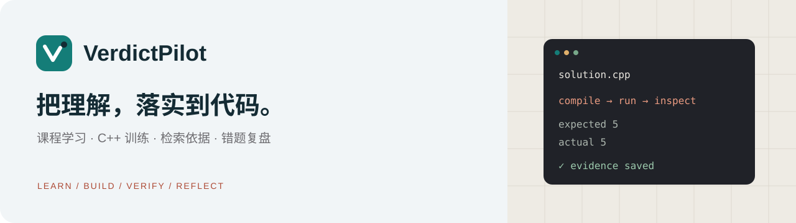
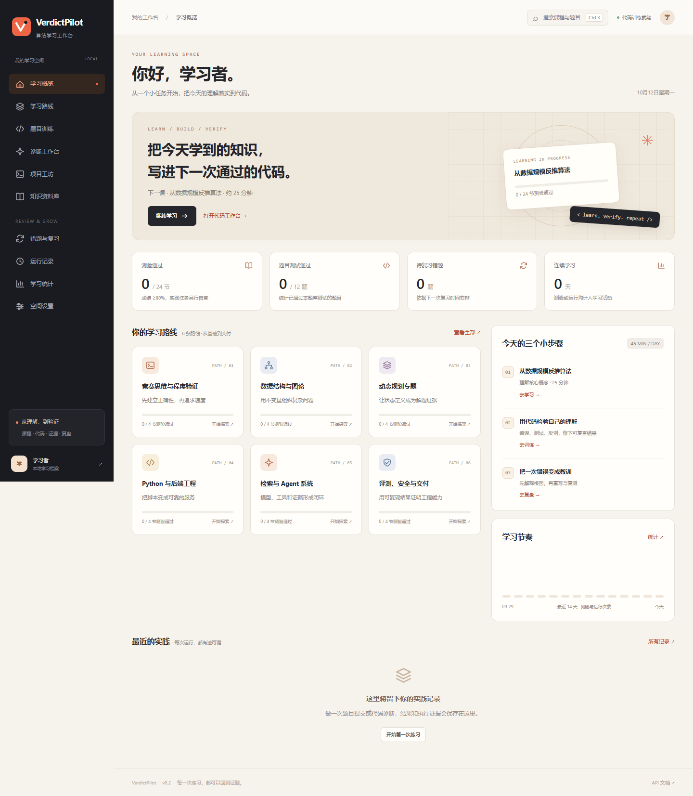
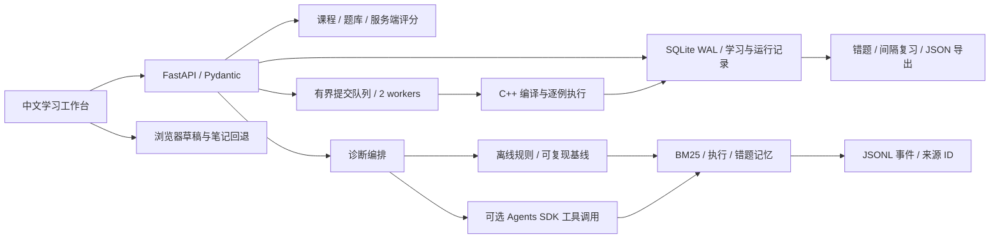

# VerdictPilot

[](https://github.com/00lostin00/VerdictPilot/actions/workflows/ci.yml)
[](pyproject.toml)
[](LICENSE)

[快速运行](#快速运行) · [工作台](#工作台) · [架构](#架构) · [验证范围](#示例与验证) · [参考与取舍](#参考与取舍) · [文档](#文档)

一个可以在本机运行的算法学习工作台。阅读课程、编写 C++、检查执行证据、记录错误并安排下一次复习，放在同一条学习流程里。默认使用本地知识与离线规则，课程、检索和记录无需模型 Key。



## 功能

| 模块 | 内容 |
| --- | --- |
| 训练内容 | 6条路径、24节课程、48道测验、12道代码题和61个固定判题用例 |
| 代码诊断 | BM25检索、C++测试证据、逐用例输出和调用轨迹 |
| 记忆与复习 | SQLite错题记录、笔记、草稿和复习反馈 |
| 工具接口 | 知识检索、代码测试、错题读取与写入四类函数工具 |
| 后台执行 | 有界提交队列、并发拒绝、超时/输出清理和中断标记 |
| Web与API | 原生中文工作台、桌面/手机布局、任务历史、知识检索和档案导出 |

## 工作台

| 场景 | 实际操作 |
| --- | --- |
| 学习概览 | 从推荐课程继续学习，查看实际测验成绩、题目通过数与 14 天活动 |
| 题库筛选 | 组合关键词、标签、难度、完成状态；按难度或未通过优先排序 |
| 代码工作台 | 行号、光标位置、多行 Tab / Shift Tab、Ctrl S 保存、Ctrl Enter 提交 |
| 代码与草稿 | 一键复制与导出 `.cpp`；恢复模板可撤销；浏览器立即存草稿，服务端串行保存 |
| 执行结果 | 逐用例查看期望与实际输出，返回页面恢复本会话最近任务，不重复提交 |
| 诊断与来源 | 离线规则整合检索和可选执行证据，来源可打开完整文档，轨迹可逐事件检查 |
| 复盘与导出 | 有错误证据的运行可写入错题本；提交复习反馈；导出个人学习记录 JSON |

前端没有构建步骤和外部运行时 CDN。原创 SVG 标识、米白背景、深墨导航和橘红操作色用于区分学习、编写与结果区域。键盘焦点、加载态、空结果、保存失败及移动窄屏均有独立处理。操作细节见 [前端说明](docs/FRONTEND.md)。

## 快速运行

需要 Python 3.11+ 和 uv；运行 C++ 测试还需 g++。

```bash
git clone https://github.com/00lostin00/VerdictPilot.git
cd VerdictPilot
uv sync --frozen --extra dev
uv run --frozen --extra dev verdictpilot serve --port 8000
```

访问 http://127.0.0.1:8000，接口文档在 `/docs`。默认关闭代码执行，课程、测验、离线检索与笔记仍可使用。

可以先体验一个不执行代码的闭环：打开「学习路线」→「复杂度」→完成测验并写笔记→在「诊断工作台」直接提交默认网格最短路题面→打开检索来源与调用轨迹。

若已经检查过要运行的本地可信代码，可显式启动：

```bash
uv run --frozen verdictpilot serve --port 8000 --trusted-local
```

该模式只用于本机可信代码练习；宿主机执行不提供文件、网络或内存隔离。受限 Docker 后端的配置见 [平台说明](docs/PLATFORM.md)和[威胁模型](docs/THREAT_MODEL.md)。

## 架构



代码提交与诊断是两条不同路径：提交使用题库固定用例，在队列中异步执行；诊断整合题面、检索与可选代码证据。离线诊断固定工具顺序，模型模式才由模型决定工具调用。运行状态与最终判定分别保存，完成处理不等于测试通过。

## 示例与验证

```bash
uv run --frozen --extra dev verdictpilot analyze --input examples/graph-hint.json --provider offline
uv run --frozen --extra dev pytest
uv run --frozen --extra dev ruff check .
uv run --frozen --extra dev verdictpilot eval
uv run --frozen --extra dev python tools/verify_bank.py
```

浏览器回归包含真实的课程测验、笔记刷新、题库筛选、草稿恢复、代码下载、WA 提交、错题复习、修复通过、离线诊断、来源检索、轨迹、项目证据和移动布局：

```bash
uv sync --frozen --extra dev --extra browser
uv run --frozen --extra dev --extra browser python tools/smoke_browser.py --channel chrome
```

该脚本在临时数据目录和独立浏览器档案中启动服务，只执行仓库内的固定测试代码；结果放在忽略提交的 `tmp/browser/`。没有安装 Chrome 时可安装 Playwright Chromium，并传 `--channel chromium`。

[浏览器验收记录](docs/browser-workbench.json)保留本轮已跑通的操作与视口范围；[代码训练截图](docs/screenshots/training.png)展示实际逐用例结果。

本地固定验证为 24 项测试、7 条离线回归、12 份参考程序通过 61 个题库用例。它们证明这些流程与样本的行为，不是大模型诊断准确率，也不是对其他框架的性能胜出。可选模型使用 `OPENAI_API_KEY`、`OPENAI_MODEL` 及 `VERDICTPILOT_PROVIDER=openai`，配置从环境变量读取，不自动加载 `.env`。真实模型效果和 Docker runner 未在这组本地记录中验证。

## 参考与取舍

以下项目用于理解不同工程边界，未作为本项目的代码依赖，也未做横向性能实验。链接指向各项目的官方仓库，定位依据其 README。

| 参考项目 | 官方项目的重点 | VerdictPilot 的定位与取舍 |
| --- | --- | --- |
| [Judge0](https://github.com/judge0/judge0) | 面向代码执行的 HTTP JSON API，提供多语言与沙箱执行能力 | 目前固定 C++20，运行与输出受限；重点是执行结果如何进入学习和复盘流程。默认关闭执行；本地后端不具备 Judge0 的隔离边界，未集成 Judge0 |
| [DOMjudge](https://github.com/DOMjudge/domjudge) | 面向 ICPC 等编程比赛的竞赛判题系统 | 面向个人训练，提供课程、笔记与错题间隔复习；没有竞赛管理、队伍排名或比赛运营功能，未集成 DOMjudge |
| [LangGraph](https://github.com/langchain-ai/langgraph) | 长期运行、有状态 Agent 的编排、持久执行与人工干预机制 | 当前使用离线固定编排和可选 Agents SDK；学习状态由 SQLite 保存，进程任务重启会标记中断而非从检查点续跑，未集成 LangGraph |

实际 Python 依赖见 [pyproject.toml](pyproject.toml) 与 [uv.lock](uv.lock)：FastAPI、Pydantic、Uvicorn 和 OpenAI Agents SDK。BM25、学习状态存储、后台提交队列与复习规则在本仓库实现。前端使用浏览器原生 HTML / CSS / JavaScript；上述对比不表示已复制参考项目的界面或源码。

下一步可用相同查询集比较 BM25 与向量召回，并记录每条查询的来源命中、延迟和失败类别；若面向多人服务，应先补认证、授权、独立执行资源与持久队列。项目工坊提供实施计划和证据录入，但这些进阶能力需要实际完成后再报告结果。

## 文档

- [架构](docs/ARCHITECTURE.md)
- [前端与体验](docs/FRONTEND.md)
- [平台与部署](docs/PLATFORM.md)
- [威胁模型](docs/THREAT_MODEL.md)
- [评测范围](docs/EVAL_RESULTS.md)

| 目录 | 内容 |
| --- | --- |
| `web/` | 原生前端、Logo 与本地静态资源 |
| `src/verdictpilot/` | API、诊断工具、执行器和学习平台服务 |
| `content/` | 版本化课程、题目、参考解与工坊计划 |
| `knowledge/` | 可检索的算法与工程知识资料 |
| `tests/`、`evals/`、`tools/` | 自动测试、固定离线回归、题库验证及浏览器验收 |
| `docs/` | 架构、使用方式、执行边界与实际界面截图 |

当前面向单实例本地训练。学习标识不等于登录身份，公网多用户服务需要认证、授权与独立执行环境。课程和项目里程碑是训练内容，不表示用户已经完成所有进阶实现。

MIT License.
