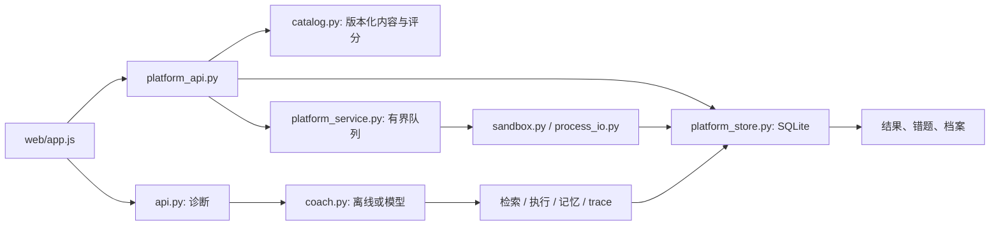
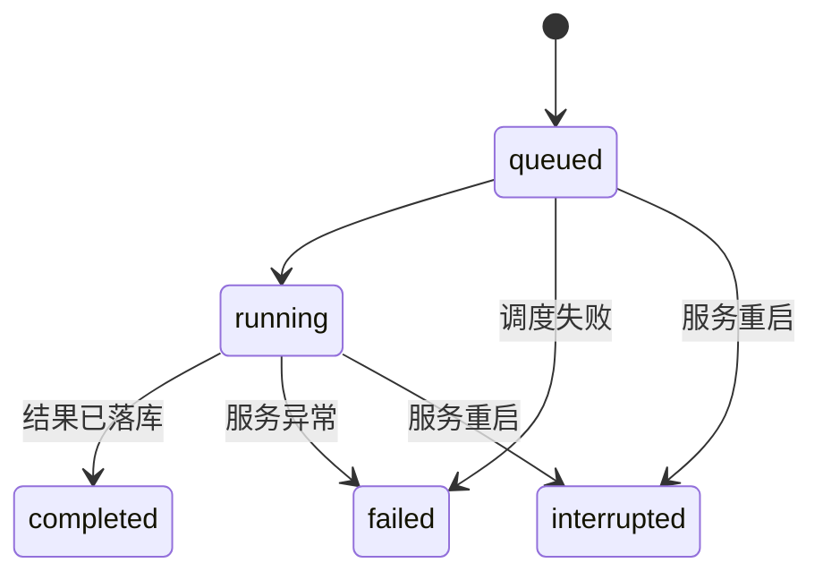

# 平台实现与部署

## 从源码读一个闭环



推荐阅读顺序：

1. `content/curriculum.json`、`content/problems.json`、`content/projects.json`：理解教学内容、公开样例、判题用例、参考解与里程碑的区别。
2. `platform_models.py`、`platform_api.py`、`catalog.py`：理解请求校验、服务端评分与返回数据裁剪。
3. `platform_store.py`：跟踪测验成绩、笔记、草稿、任务、复习和证据如何保存。
4. `platform_service.py`、`sandbox.py`、`process_io.py`：跟踪排队、编译、逐例执行、输出限制与失败记录。
5. `coach.py`、`offline.py`、`openai_agent.py`、`knowledge.py`、`memory.py`、`tracing.py`：理解诊断如何引用检索与工具证据。
6. `web/app.js`、`web/styles.css`：跟踪路由、加载态、自动保存、任务轮询、错误提示与移动布局。
7. `tests/test_platform.py`、`tools/verify_bank.py`、`tools/smoke_browser.py`：理解接口边界、固定题库校验与真实浏览器流程分别证明什么。

## 数据与指标定义

数据库与 trace 默认位于 `data/`，旧版 `mistakes` 和 `knowledge_documents` 表继续使用，新增平台表使用 `vp_` 前缀。

| 表 | 数据 |
| --- | --- |
| `vp_profiles` | 本地学习标识、显示名称、目标、每天计划时长 |
| `vp_progress` | 最佳和最近测验成绩、笔记、自己报告的练习状态 |
| `vp_quiz_attempts` | 每次测验尝试的成绩与时间 |
| `vp_runs` | 代码、任务种类、执行状态、判定、结果和错误 |
| `vp_drafts` | 每道题最近保存的代码 |
| `vp_reviews` | 有错误执行证据的错题、下次复习日期、间隔与反馈 |
| `vp_project_evidence` | 项目里程碑的命令、产物、说明、指标与更新时间 |

SQLite 开启 WAL，连接使用短事务、busy timeout，并在结束后关闭。题库和课程是文件版本，学习记录是数据库内容。不要用删除 `content/` 或 `knowledge/` 来清理运行数据。

课程测验达到 80 分计为通过，最佳分与最近分分别保存。练习勾选不会增加测验通过数。题目通过只计有实际 runner `passed` 的提交；关闭执行不计通过。14 天活动统计测验尝试和提交/诊断请求，使用 UTC+8 日期；连续天数允许今天尚未开始时从昨天计起。不是学习时长测量。

错题来源必须是 WA、CE、TLE、RE 或输出超限的执行记录。重复保存同一运行会更新说明；复习采用简单间隔规则：again 为 1 天，hard 保持间隔，good 倍增，easy 三倍，最多 90 天。这是复习提醒，不是经过个体校准的记忆预测模型。

JSON 导出包含当前学习标识的档案、进度、测验、代码草稿、运行、复习与项目证据。浏览器首次访问生成标识并放在 localStorage，服务端按这个标识查数据；知道标识的人可以访问该档案，因此它不构成身份认证。

## 任务与故障行为

提交接口返回 `202` 和 `run_id`，前端轮询运行详情。两个 worker 执行判题，16 个容量包含排队和正在执行的任务；饱和返回 `429` 与 `Retry-After: 3`。诊断请求单独限制为同时 4 个，仍同步返回诊断结果。



`completed` 表示处理完成，判定字段可以是通过、WA、CE、TLE、RE、输出超限或执行关闭。服务异常会保存失败状态，详情返回简短错误，内部异常写服务日志。重启恢复只在服务器启动时执行，不会由普通 CLI 建索引触发。

任务队列目前在单个进程内，重启会标记中断，不会续跑。使用单个服务实例；多个 worker 或实例共享数据库会产生恢复竞争。幂等提交、取消 API、worker 租约和外部持久队列是工坊中需要实际完成的进阶工作。

## 主要 API

在 `/docs` 查看全部请求 schema。平台路由接受 `learner_id`，旧诊断 API 未指定该查询参数时继续使用请求内的 `session_id`。

| 请求 | 行为 |
| --- | --- |
| `GET /health`、`GET /v1/dashboard` | 运行配置与实际学习概览 |
| `GET /v1/catalog`、`GET /v1/lessons/{id}` | 课程目录与内容，测验答案在提交前不返回 |
| `POST /v1/lessons/{id}/quiz`、`PUT .../note` | 服务端评分、保存笔记与练习状态 |
| `GET /v1/problems`、`GET /v1/problems/{id}` | 题目、公开样例、提示和题解；不返回参考程序与隐藏判题用例 |
| `PUT /v1/problems/{id}/draft`、`POST .../submit` | 草稿持久化、后台判题 |
| `GET /v1/runs`、`GET /v1/runs/{id}` | 分页运行记录、结果与诊断事件 |
| `POST /v1/analyze` | 离线或模型诊断，结果关联平台运行记录 |
| `GET/POST /v1/reviews`、`POST .../{id}/practice` | 保存有执行证据的错题并更新复习日期 |
| `GET /v1/knowledge/documents`、`GET .../{id}` | 知识目录与正文 |
| `GET /v1/knowledge/search?q=...` | BM25 检索，最大查询长度 300 |
| `GET /v1/projects`、`PUT .../{id}/milestones/{id}` | 工坊方案与学习者证据记录 |
| `GET/PUT /v1/profile`、`GET /v1/export` | 档案设置与导出 |

服务端约束代码、题面、测试输入和输出大小。文档使用已入库 ID 查询，不把客户端路径拼入文件系统。运行详情只读取 trace 最后 2 MB，并返回匹配运行的最多 100 条事件；较旧事件仍可在本地完整 JSONL 中复盘。

## 运行模式与部署

普通学习建议离线 provider；课程和题库不依赖模型 Key。模型模式需要在环境变量中设置 API Key、账户可用模型与 provider，且会产生实际 API 费用。当前本地验证没有调用真实模型。

执行模式有三种：

- `disabled`：默认值，课程、测验和笔记可用，代码不执行。
- `local`：仅使用者的可信代码；`serve --trusted-local` 同时开启执行与显式授权，并要求 loopback host。本地 runner 限制运行时间及输出缓存，不能隔离宿主机文件、网络和内存。
- `docker`：独立受限 runner。它具有容器的资源与权限限制；不能等同于生产级恶意代码隔离，且本次没有运行验证。

Docker runner 构建与使用示例：

```powershell
docker build -t verdictpilot-sandbox:latest .\sandbox
$env:VERDICTPILOT_EXECUTION_BACKEND = "docker"
uv run --frozen verdictpilot serve
```

应用容器可以通过 `docker compose up --build` 启动，绑定宿主机 `127.0.0.1:8000`，默认执行关闭，数据放在命名卷。应用容器不含宿主机 g++ 或 Docker socket；不能通过把执行环境变量改成 local 就得到可用判题服务。

`VERDICTPILOT_PROJECT_ROOT` 可以指定包含 `web/`、`content/` 和 `knowledge/` 的项目根目录；`VERDICTPILOT_DATA_DIR` 指定持久化目录。应用镜像设置根目录为 `/app`。安装 wheel 到其他环境时，仍需携带这些资源并指定根目录。

## 验证的范围

单元与接口测试验证内容裁剪、评分、持久化、数据归属、队列背压、执行关闭、失败释放容量、重启中断、旧会话兼容、trace 与证据校验。子进程测试验证输出上限和超时。

`verify_bank.py` 用每题的参考解执行全部固定用例，证明当前参考解和判题数据一致。它不能证明用例足以覆盖所有错误解。原 7 条离线评测属于小型回归集，不能证明模型诊断泛化。

`smoke_browser.py` 在临时数据库与独立无头浏览器中跑通课程、笔记、提交与修复、复习、诊断、检索、工坊、档案导出和移动端布局，保存截图与 Playwright trace。桌面截图见 [概览](screenshots/dashboard.png)、[训练](screenshots/training.png)，手机见 [移动端](screenshots/mobile.png)。

这些检查为本地验证。新增 CI 尚待远端运行；Docker 隔离与真实模型质量需要各自的运行证据。
